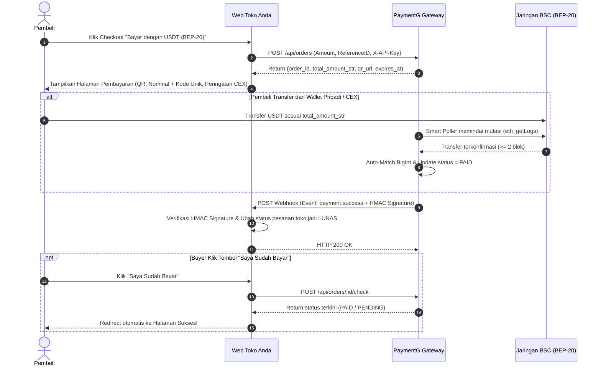

# PANDUAN INTEGRASI MANDIRI: USDT BEP-20 GATEWAY
## Panduan Resmi untuk Developer & AI Coding Agent (Cursor, Claude, ChatGPT, Antigravity)

> [!IMPORTANT]
> **PETUNJUK CEPAT UNTUK PEMILIK TOKO:**
> Anda tidak perlu repot menulis kode sendiri. Cukup berikan file ini (`INTEGRATION_GUIDE.md`) kepada AI Coding Agent Anda (Cursor, Claude Code, Copilot, ChatGPT, dll.) dengan prompt berikut:
>
> *"Tolong integrasikan gateway pembayaran USDT BEP-20 ke website toko ini sesuai spesifikasi di `INTEGRATION_GUIDE.md`. Saya sudah menambahkan `USDT_GATEWAY_URL` dan `USDT_API_KEY` di file `.env` toko."*
>
> AI Agent akan membaca file ini dan menyelesaikan integrasi secara otomatis.

---

## 1. Variabel Lingkungan di Toko Anda (`.env`)

PaymentG USDT menerapkan **Pemisahan Kredensial 100% (Zero-Trust Decoupling)** untuk keamanan dana:
- Kunci Produksi ber-prefix **`ak_live_...`** (hanya bekerja di endpoint Live).
- Kunci Uji Coba ber-prefix **`ak_test_...`** (hanya bekerja di endpoint Sandbox).

Tambahkan konfigurasi berikut ke file `.env` website toko Anda:

```ini
# URL Gateway (Gunakan URL Sandbox saat pengujian, dan URL Domain/VPS saat Live)
USDT_GATEWAY_URL=http://localhost:3900

# API Key Toko:
# - Saat Pengujian (Sandbox): gunakan kunci ber-prefix ak_test_...
# - Saat Produksi (Live): gunakan kunci ber-prefix ak_live_...
USDT_API_KEY=ak_live_xxxxxxxxxxxxxxxxxxxxxxxxxxxxxxxx
```

---

## 2. Alur Transaksi End-to-End



---

## 3. Spesifikasi Kontrak REST API

### A. Membuat Tagihan Baru
- **Endpoint Live:** `POST ${PAYMENTG_BASE_URL}/api/orders`
- **Endpoint Sandbox:** `POST ${PAYMENTG_BASE_URL}/api/sandbox/orders`
- **Headers:**
  - `Content-Type: application/json`
  - `X-API-Key: ${PAYMENTG_API_KEY}` (atau `Authorization: Bearer ${PAYMENTG_API_KEY}`)

#### Request Body:
```json
{
  "reference_id": "INV-2026-001",
  "amount": 10.50,
  "currency": "USDT"
}
```
*Catatan: `reference_id` bersifat idempoten. Jika dipanggil ulang saat pesanan masih PENDING, PaymentG akan mengembalikan tagihan yang ada tanpa membuat kode unik baru.*

#### Response Sukses (`HTTP 201 Created` / `HTTP 200 OK`):
```json
{
  "success": true,
  "data": {
    "order_id": "ord_9xK2mP7vLq1A",
    "reference_id": "INV-2026-001",
    "network": "BSC (BEP-20)",
    "chain_id": 56,
    "currency": "USDT",
    "token_contract": "0x55d398326f99059fF775485246999027B3197955",
    "wallet_address": "0x71C67Ed3484A222ab20E083d9204E646A803D0A1",
    "original_amount": 10.5,
    "unique_code": 14,
    "total_amount": 10.514,
    "total_amount_str": "10.514",
    "cex_warning": "PENTING: Hanya kirim USDT melalui jaringan BNB Smart Chain (BEP-20). Jika mengirim dari Exchange (Indodax/Tokocrypto/Bybit/Binance), pastikan Jumlah Bersih Diterima (Receive Amount) adalah TEPAT 10.514 USDT setelah dikurangi biaya penarikan.",
    "status": "PENDING",
    "qr_url": "http://localhost:3400/api/orders/ord_9xK2mP7vLq1A/qr.png",
    "expires_at": "2026-10-16T15:15:00Z",
    "expires_in_seconds": 900
  }
}
```

---

### B. Cek Status Tagihan & Tombol "Saya Sudah Bayar"
- **Endpoint Live:** `POST ${PAYMENTG_BASE_URL}/api/orders/:id/check`
- **Endpoint Sandbox:** `POST ${PAYMENTG_BASE_URL}/api/sandbox/orders/:id/check`
- **Headers:** Publik (tidak wajib menyertakan API Key, aman dipanggil langsung oleh frontend browser pembeli).

#### Response:
```json
{
  "success": true,
  "data": {
    "order_id": "ord_9xK2mP7vLq1A",
    "status": "PAID",
    "total_amount_str": "10.514",
    "tx_hash": "0x8a9f7c6d5e4b3a2f1e0d9c8b7a6f5e4d3c2b1a0f9e8d7c6b5a4f3e2d1c0b9a8f",
    "paid_at": "2026-10-16T15:03:12Z",
    "scanned_now": true,
    "next_check_in_seconds": 0
  }
}
```

---

## 4. Menangani Notifikasi Webhook (`payment.success`)

Ketika pembayaran terkonfirmasi di blockchain BSC, PaymentG akan mengirimkan webhook HTTP POST ke `webhook_url` toko Anda.

### Headers Webhook:
- `Content-Type: application/json`
- `User-Agent: PaymentG-Webhook-Bot/1.0`
- `X-Webhook-Event: payment.success`
- `X-Webhook-Timestamp: <unix_timestamp_detik>`
- `X-Webhook-Signature: <hex_hmac_sha256_of_raw_body_using_api_key>`

### Payload JSON:
```json
{
  "event": "payment.success",
  "is_sandbox": false,
  "order_id": "ord_9xK2mP7vLq1A",
  "reference_id": "INV-2026-001",
  "network": "BSC (BEP-20)",
  "currency": "USDT",
  "original_amount": 10.5,
  "unique_code": 14,
  "total_amount": 10.514,
  "total_amount_str": "10.514",
  "wallet_address": "0x71C67Ed3484A222ab20E083d9204E646A803D0A1",
  "from_address": "0xBuyerSenderWalletAddressHere",
  "tx_hash": "0x8a9f7c6d5e4b3a2f1e0d9c8b7a6f5e4d3c2b1a0f9e8d7c6b5a4f3e2d1c0b9a8f",
  "block_number": 43120950,
  "paid_at": "2026-10-16T15:03:12Z",
  "timestamp": 1760616192
}
```

---

## 5. Implementasi Backend Lengkap (Copy-Paste Ready)

### A. PHP / Laravel Controller

Buat file `app/Http/Controllers/PaymentGWebhookController.php`:

```php
<?php

namespace App\Http\Controllers;

use Illuminate\Http\Request;
use Illuminate\Support\Facades\Log;
use App\Models\Order; // Sesuaikan dengan model order Anda

class PaymentGWebhookController extends Controller
{
    public function handle(Request $request)
    {
        $apiKey = env('PAYMENTG_API_KEY');
        $rawContent = $request->getContent();
        $signature = $request->header('X-Webhook-Signature');

        // 1. Verifikasi HMAC Signature
        $expectedSignature = hash_hmac('sha256', $rawContent, $apiKey);
        if (!hash_equals($expectedSignature, (string)$signature)) {
            Log::warning('[PaymentG] Webhook Signature Mismatch');
            return response()->json(['error' => 'Invalid signature'], 401);
        }

        $payload = json_decode($rawContent, true);
        if (($payload['event'] ?? '') !== 'payment.success') {
            return response()->json(['received' => true]);
        }

        $referenceId = $payload['reference_id'];
        $txHash = $payload['tx_hash'];

        // 2. Update Status Pesanan di Database Toko Anda
        $order = Order::where('invoice_number', $referenceId)->first();
        if ($order && $order->status !== 'PAID') {
            $order->update([
                'status' => 'PAID',
                'tx_hash' => $txHash,
                'paid_at' => now(),
            ]);
            Log::info("[PaymentG] Pesanan {$referenceId} berhasil dilunaskan via BSC tx: {$txHash}");
        }

        return response()->json(['received' => true]);
    }
}
```
*Daftarkan di `routes/api.php`:*
```php
Route::post('/webhooks/paymentg', [PaymentGWebhookController::class, 'handle']);
```

---

### B. Node.js (Next.js App Router - TypeScript)

Buat file `app/api/webhooks/paymentg/route.ts`:

```typescript
import { NextRequest, NextResponse } from 'next/server';
import crypto from 'crypto';

export async function POST(req: NextRequest) {
  const apiKey = process.env.PAYMENTG_API_KEY || '';
  const rawBody = await req.text();
  const signature = req.headers.get('x-webhook-signature') || '';

  // 1. Verifikasi HMAC Signature
  const expectedSig = crypto
    .createHmac('sha256', apiKey)
    .update(rawBody)
    .digest('hex');

  if (signature !== expectedSig) {
    return NextResponse.json({ error: 'Invalid signature' }, { status: 401 });
  }

  const payload = JSON.parse(rawBody);
  if (payload.event === 'payment.success') {
    const { reference_id, tx_hash } = payload;
    console.log(`[PaymentG] Pesanan ${reference_id} LUNAS via Tx: ${tx_hash}`);
    
    // TODO: Update status pesanan di database toko Anda (misal Prisma / Drizzle)
    // await prisma.order.update({ where: { invoiceId: reference_id }, data: { status: 'PAID' } });
  }

  return NextResponse.json({ received: true });
}
```

---

### C. Node.js (Express.js)

```javascript
const express = require('express');
const crypto = require('crypto');
const app = express();

// PENTING: Gunakan express.raw agar body tidak rusak saat kalkulasi HMAC
app.post('/api/webhooks/paymentg', express.raw({ type: 'application/json' }), (req, res) => {
  const apiKey = process.env.PAYMENTG_API_KEY;
  const receivedSig = req.headers['x-webhook-signature'];
  const rawBody = req.body;

  const expectedSig = crypto.createHmac('sha256', apiKey).update(rawBody).digest('hex');
  if (receivedSig !== expectedSig) {
    return res.status(401).json({ error: 'Invalid signature' });
  }

  const payload = JSON.parse(rawBody.toString('utf-8'));
  if (payload.event === 'payment.success') {
    console.log(`Pesanan ${payload.reference_id} telah lunas! Tx: ${payload.tx_hash}`);
    // Update database toko Anda
  }

  res.status(200).json({ received: true });
});
```

---

### D. Python (FastAPI)

```python
import hmac
import hashlib
from fastapi import FastAPI, Request, HTTPException

app = FastAPI()
API_KEY = "ak_xxxxxxxxxxxxxxxxxxxxxxxxxxxxxxxx"

@app.post("/api/webhooks/paymentg")
async def paymentg_webhook(request: Request):
    raw_body = await request.body()
    signature = request.headers.get("x-webhook-signature", "")

    expected_sig = hmac.new(API_KEY.encode(), raw_body, hashlib.sha256).hexdigest()
    if not hmac.compare_digest(expected_sig, signature):
        raise HTTPException(status_code=401, detail="Invalid signature")

    payload = await request.json()
    if payload.get("event") == "payment.success":
        ref_id = payload.get("reference_id")
        tx_hash = payload.get("tx_hash")
        print(f"[PaymentG] Invoice {ref_id} lunas! Tx: {tx_hash}")
        # Update database toko Anda

    return {"received": True}
```

---

## 6. Komponen Frontend Checkout Interaktif (Lengkap dengan Peringatan CEX)

Tampilkan komponen ini pada halaman checkout toko Anda ketika pembeli memilih opsi pembayaran **USDT (BEP-20)**. Komponen ini sudah menangani:
1. Render QR Code dinamis dari PaymentG.
2. Countdown timer 15 menit.
3. Tombol salin nominal & alamat dompet.
4. Kotak peringatan biaya penarikan exchange (CEX Warning).
5. Auto-polling status setiap 3 detik + tombol "Saya Sudah Bayar" instan.
6. Auto-redirect saat status berubah menjadi `PAID`.

```html
<!-- PaymentG Interactive Checkout Widget -->
<div id="paymentg-checkout" class="max-w-md mx-auto bg-[#181a20] border border-[#f0b90b] rounded-2xl p-6 text-white font-sans shadow-2xl">
  
  <!-- Header -->
  <div class="text-center mb-4">
    <div class="inline-flex items-center gap-1.5 px-3 py-1 rounded-full bg-[#f0b90b]/15 text-[#f0b90b] text-xs font-semibold mb-2">
      <span>🟡</span> BNB Smart Chain (BEP-20)
    </div>
    <h3 class="text-xl font-bold">Pembayaran USDT BEP-20</h3>
    <p class="text-xs text-gray-400">Scan QR atau transfer nominal eksak ke alamat berikut:</p>
  </div>

  <!-- QR Code Image -->
  <div class="bg-white p-3 rounded-2xl w-56 h-56 mx-auto mb-4 flex items-center justify-center shadow-lg">
    
  </div>

  <!-- Countdown Timer -->
  <div class="text-center mb-4">
    <span class="text-xs text-gray-400">Sisa Waktu Pembayaran:</span>
    <div id="pg-timer" class="text-base font-bold font-mono text-[#f0b90b]">14:59</div>
  </div>

  <!-- Detail Nominal Eksak & Kode Unik -->
  <div class="bg-[#0b0e11] border border-gray-800 rounded-xl p-3.5 space-y-2 mb-4">
    <div class="flex justify-between items-center text-xs text-gray-400">
      <span>Jumlah yang WAJIB Diterima:</span>
      <button onclick="copyPG('pg-amount-str')" class="text-[#f0b90b] hover:underline text-[11px]">Salin Nominal</button>
    </div>
    <div class="flex items-baseline justify-between">
      <span id="pg-amount-str" class="text-2xl font-black font-mono text-[#f0b90b]">0.000</span>
      <span class="text-sm font-bold text-gray-300">USDT</span>
    </div>
    <p class="text-[11px] text-amber-300/80">⚠️ Wajib transfer persis 3 desimal untuk verifikasi otomatis.</p>
  </div>

  <!-- Alamat Dompet -->
  <div class="bg-[#0b0e11] border border-gray-800 rounded-xl p-3.5 mb-4">
    <div class="flex justify-between items-center text-xs text-gray-400 mb-1">
      <span>Alamat Dompet Penerima:</span>
      <button onclick="copyPG('pg-wallet')" class="text-[#f0b90b] hover:underline text-[11px]">Salin Alamat</button>
    </div>
    <div id="pg-wallet" class="font-mono text-xs text-gray-200 break-all select-all">0x...</div>
  </div>

  <!-- KOTAK PERINGATAN BIAYA PENARIKAN CEX -->
  <div class="bg-amber-950/40 border border-amber-600/60 rounded-xl p-3.5 text-xs text-amber-200 mb-5 space-y-1.5">
    <div class="font-bold flex items-center gap-1.5 text-amber-300">
      <span>⚠️</span> PERINGATAN PENGIRIM DARI EXCHANGE (CEX):
    </div>
    <p class="text-[11px] leading-relaxed text-gray-300">
      Jika mengirim dari <strong>Indodax, Tokocrypto, Bybit, atau Binance</strong>, exchange akan memotong biaya penarikan (withdrawal fee). Pastikan <strong>"Jumlah Bersih Diterima" (Receive Amount)</strong> adalah <strong>TEPAT <span id="pg-warn-amount" class="text-[#f0b90b] font-bold">0.000</span> USDT</strong>, bukan nominal kotor sebelum dipotong fee.
    </p>
  </div>

  <!-- Tombol Saya Sudah Bayar -->
  <button id="pg-btn-check" onclick="triggerManualCheck()" class="w-full py-3.5 bg-[#f0b90b] hover:bg-[#d9a507] text-black font-extrabold rounded-xl text-sm transition flex items-center justify-center gap-2 shadow-lg">
    <span>⚡</span> Saya Sudah Bayar
  </button>
  <p id="pg-status-info" class="text-center text-[11px] text-gray-400 mt-2">Memantau jaringan BSC secara otomatis...</p>

</div>

<script>
  let orderData = null;
  let checkInterval = null;
  let timerInterval = null;

  // Inisialisasi widget dengan response dari POST /api/orders
  function initPaymentGWidget(apiOrderResponse) {
    orderData = apiOrderResponse.data;
    document.getElementById('pg-qr').src = orderData.qr_url;
    document.getElementById('pg-amount-str').innerText = orderData.total_amount_str;
    document.getElementById('pg-warn-amount').innerText = orderData.total_amount_str;
    document.getElementById('pg-wallet').innerText = orderData.wallet_address;

    startCountdown(orderData.expires_in_seconds);
    startAutoPolling(orderData.order_id);
  }

  function startCountdown(seconds) {
    let rem = seconds;
    timerInterval = setInterval(() => {
      rem--;
      if (rem <= 0) {
        clearInterval(timerInterval);
        document.getElementById('pg-timer').innerText = "KEDALUWARSA";
        document.getElementById('pg-status-info').innerText = "Waktu pembayaran telah habis.";
        return;
      }
      const m = Math.floor(rem / 60);
      const s = rem % 60;
      document.getElementById('pg-timer').innerText = `${m}:${s < 10 ? '0' : ''}${s}`;
    }, 1000);
  }

  function startAutoPolling(orderId) {
    checkInterval = setInterval(async () => {
      try {
        const res = await fetch(`http://localhost:3400/api/orders/${orderId}/check`, { method: 'POST' });
        const d = await res.json();
        if (d.success && d.data.status === 'PAID') {
          handlePaymentSuccess(d.data);
        }
      } catch (e) {}
    }, 3000); // Polling setiap 3 detik
  }

  async function triggerManualCheck() {
    if (!orderData) return;
    const btn = document.getElementById('pg-btn-check');
    btn.disabled = true;
    btn.innerText = "Memverifikasi di Blockchain BSC...";
    try {
      const res = await fetch(`http://localhost:3400/api/orders/${orderData.order_id}/check`, { method: 'POST' });
      const d = await res.json();
      if (d.success && d.data.status === 'PAID') {
        handlePaymentSuccess(d.data);
      } else {
        document.getElementById('pg-status-info').innerText = "Belum terdeteksi di blockchain. Jika baru saja transfer, mohon tunggu 5-15 detik.";
      }
    } catch (e) {
      document.getElementById('pg-status-info').innerText = "Gagal menghubungi node BSC.";
    } finally {
      btn.disabled = false;
      btn.innerHTML = "<span>⚡</span> Saya Sudah Bayar";
    }
  }

  function handlePaymentSuccess(data) {
    clearInterval(checkInterval);
    clearInterval(timerInterval);
    document.getElementById('paymentg-checkout').innerHTML = `
      <div class="text-center py-8 space-y-4">
        <div class="w-16 h-16 bg-emerald-500/20 text-emerald-400 border border-emerald-500/40 rounded-full flex items-center justify-center text-3xl mx-auto">✓</div>
        <h3 class="text-2xl font-bold text-white">Pembayaran Sukses!</h3>
        <p class="text-xs text-gray-300">Transaksi telah diverifikasi di blockchain BNB Smart Chain.</p>
        <div class="text-[11px] font-mono text-[#f0b90b] break-all">Tx: ${data.tx_hash}</div>
        <p class="text-xs text-gray-400">Mengalihkan ke halaman pesanan Anda...</p>
      </div>
    `;
    setTimeout(() => {
      window.location.href = `/order-success?ref=${orderData.reference_id}`;
    }, 2500);
  }

  function copyPG(elemId) {
    const text = document.getElementById(elemId).innerText;
    navigator.clipboard.writeText(text).then(() => {
      alert("Tersalin ke clipboard: " + text);
    });
  }
</script>
```

---

## 7. Pengujian Menggunakan Simulator Sandbox

Sebelum merilis ke publik, Anda dapat menguji seluruh alur integrasi tanpa kripto riil:
1. Di `.env` toko Anda, arahkan request pembuatan tagihan ke endpoint sandbox:
   `POST http://localhost:3400/api/sandbox/orders`
2. Buka antarmuka simulator di browser:
   `http://localhost:3400/sandbox/`
3. Anda akan melihat tagihan yang baru dibuat oleh toko Anda dengan status `PENDING`.
4. Klik tombol **[ ⚡ Simulasikan Bayar (1-Klik) ]**.
5. PaymentG akan:
   - Mengubah status pesanan menjadi `PAID`.
   - Menghasilkan simulated hash transaksi `0xsandbox...`.
   - Mengirimkan request Webhook ber-signature HMAC-SHA256 ke endpoint toko Anda.
   - Halaman checkout toko pembeli akan otomatis mendeteksi lunas dan melakukan redirect!
