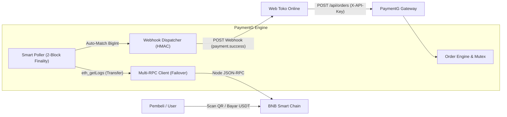

# PaymentG — USDT BEP-20 (BSC On-Chain Edition)

[](https://golang.org)
[-F0B90B?style=flat&logo=binance)](https://bscscan.com)
[-26A17B?style=flat&logo=tether)](https://bscscan.com/token/0x55d398326f99059fF775485246999027B3197955)
[](LICENSE)

**PaymentG (USDT BEP-20 Edition)** adalah *self-hosted Web3 crypto payment gateway* mandiri berkinerja tinggi (Go + Gin + Pure-Go SQLite) yang memantau mutasi token **USDT (Binance-Peg BSC-USD)** di jaringan **BNB Smart Chain (BEP-20)** secara langsung melalui node **EVM JSON-RPC** tanpa memerlukan API Key pihak ketiga dan **tanpa menyimpan Private Key (100% Non-Custodial / Watch-Only Wallet)**.

---

## 🌟 Fitur Utama

1. **100% Non-Custodial (Watch-Only):**
   - Server sama sekali tidak menyimpan *Private Key* maupun *Seed Phrase*.
   - Seluruh dana USDT dari pembeli langsung mendarat di dompet pribadi Anda di blockchain.
2. **Multi-RPC Auto-Failover EVM Client:**
   - Memantau on-chain langsung via JSON-RPC (`eth_blockNumber` & `eth_getLogs`) ke berbagai node publik BSC (`bsc-rpc.publicnode.com`, `1rpc.io/bnb`, `bsc.meowrpc.com`, dll.).
   - Dilengkapi *timeout* 5 detik per node dan auto-switch instan jika salah satu node diblokir atau mengalami rate-limit.
3. **Smart Cursor Poller & 2-Block Finality:**
   - Memindai transaksi hingga `safeBlock = latestBlock - 2` (~6 detik) untuk menjamin finalitas anti-*chain-reorg*.
   - *Tail-Polling* otomatis berjalan selama 15 menit untuk menangkap transfer bursa CEX yang terlambat.
   - Poller tertidur (*idle*) secara otomatis jika tidak ada pesanan aktif untuk menghemat bandwidth server.
4. **Anti-Sub-Milli Spoofing & Anti-Poisoning:**
   - Parsing presisi BigInt dengan pembagian eksak `rawWei.DivMod(10^15)`.
   - Pecahan aneh sub-milli atau *0-value transfer poisoning* otomatis dialihkan ke tabel mutasi tak dikenal (`unmatched_transactions`).
5. **Penyelamatan Biaya Penarikan Bursa (CEX Fee Rescue):**
   - Pembeli yang mengirim dana via exchange (Indodax, Tokocrypto, Bybit, Binance) terkadang lupa menambahkan biaya penarikan, sehingga nominal yang masuk berkurang.
   - Sediakan fitur **Manual Match / Force Approve** di Dashboard Live (`POST /api/unmatched/resolve`) yang dapat memasangkan mutasi tersebut ke invoice terkait secara atomik dan langsung memicu webhook toko.
6. **Alokasi Kode Unik Mikro Adaptif (Thread-Safe):**
   - Tier 1 (< 5 USDT): +0.001 s.d +0.025 USDT.
   - Tier 2 (5 s.d < 50 USDT): +0.001 s.d +0.050 USDT.
   - Tier 3 (>= 50 USDT): +0.001 s.d +0.099 USDT.
   - *Emergency Expansion* hingga 250 slot jika semua kode sedang aktif/cooldown.
7. **Simulator Sandbox Terisolasi (1-Klik Lunas):**
   - Lingkungan pengujian terpisah di `data/sandbox/payment.db`.
   - Tombol simulasi 1-klik yang mengubah pesanan menjadi `PAID`, membuat tx hash simulasi, dan menembakkan webhook ber-signature HMAC-SHA256 ke toko Anda.
8. **QR Code Engine dengan Auto-Heal:**
   - Menyajikan file PNG 320x320 secara publik tanpa auth.
   - Otomatis membuat ulang gambar QR di disk secara instan jika file terhapus.
9. **Kinerja Tinggi & Portabel:**
   - Single Binary murni tanpa CGO (`CGO_ENABLED=0`).
   - Konsumsi RAM sangat rendah (< 25 MB RAM).

---

## 🏗️ Arsitektur Sistem



---

## 📁 Struktur Direktori Proyek

```text
paymentg-bsc/
├── data/
│   ├── payment.db               # SQLite Production (WAL Mode, MaxOpenConns=1)
│   ├── qr/                      # Cache gambar QR PNG Live (Auto-Heal)
│   └── sandbox/
│       ├── payment.db           # SQLite Sandbox Terisolasi
│       └── qr/                  # Cache gambar QR PNG Sandbox
├── dashboard/
│   ├── index.html               # UI Dashboard Live (/dashboard/) — Tema BSC Gold
│   └── sandbox.html             # UI Simulator Sandbox (/sandbox/) — Tema Emerald
├── internal/
│   ├── config/config.go         # Parser .env & runtime config thread-safe
│   ├── database/sqlite.go       # Koneksi SQLite WAL & sync apps dwiarah
│   ├── middleware/
│   │   ├── auth.go              # PIN auth, lockout 5 menit, Bearer / X-Key guards
│   │   └── cors.go              # Middleware CORS preflight
│   ├── service/
│   │   ├── bsc_rpc.go           # Multi-RPC EVM Client (eth_blockNumber, eth_getLogs)
│   │   ├── order.go             # Tier kode unik mikro, BigInt match, idempotensi
│   │   ├── poller.go            # Smart block cursor poller, 2-block finality
│   │   ├── qr.go                # Generator PNG QR 320x320 dengan Auto-Heal
│   │   └── webhook.go           # Webhook HMAC-SHA256, In-flight lock, retry backoff
│   └── handler/
│       ├── admin.go             # PIN auth, stats, apps, runtime config, test RPC
│       ├── order.go             # Client API (Create, Get, Check, Cancel, Serve QR)
│       └── sandbox.go           # Simulator Sandbox (1-Click Pay, Demo Order)
├── .env                         # Konfigurasi runtime aktif
├── .env.example                 # Template konfigurasi produksi
├── go.mod                       # Modul Go & dependensi murni
├── go.sum                       # Checksum dependensi
├── main.go                      # Server entry point, background workers & graceful shutdown
├── RESULT.md                    # Dokumentasi laporan hasil pengujian
├── INTEGRATION_GUIDE.md         # Panduan integrasi mandiri untuk developer & AI Agent
└── README.md                    # Dokumentasi master proyek
```

---

## ⚙️ Spesifikasi File Konfigurasi (`.env`)

Salin `.env.example` ke `.env`:

```ini
# Server Configuration
PORT=3400
GIN_MODE=release

# Keamanan Admin & Dashboard
ADMIN_PIN=2207
ADMIN_KEY=pg_bsc_admin_secret_key_change_me

# Konfigurasi Jaringan & Dompet Penerima (WATCH-ONLY — JANGAN MASUKKAN PRIVATE KEY!)
NETWORK_NAME=BSC (BEP-20)
CHAIN_ID=56
RECEIVER_WALLET_ADDRESS=0xYourPersonalBscWalletAddressHere
USDT_CONTRACT_ADDRESS=0x55d398326f99059fF775485246999027B3197955
USDT_DECIMALS=18

# Daftar Public RPC BSC (Auto-Failover berurutan)
BSC_RPC_URLS=https://bsc-rpc.publicnode.com,https://1rpc.io/bnb,https://bsc.meowrpc.com,https://bsc-dataseed.binance.org,https://bsc-dataseed1.defibit.io,https://bsc-dataseed1.ninicoin.io

# Pengaturan Tagihan, Finality & Poller
DEFAULT_CURRENCY=USDT
DEFAULT_EXPIRY_MINUTES=15
COOLDOWN_MINUTES=60
REQUIRED_CONFIRMATIONS=2
MIN_RPC_POLL_INTERVAL_SEC=4
BACKGROUND_SWEEP_INTERVAL_SEC=6
MAX_BLOCK_RANGE_PER_QUERY=400
```

---

## 🚀 Panduan Menjalankan & Deployment

### 1. Menjalankan di Lokal / Windows
```powershell
# Jalankan binary langsung
.\paymentg-bsc.exe

# Atau jalankan dari source code
go run main.go
```

### 2. Kompilasi Binary Produksi (CGO_ENABLED=0)
```bash
# Linux
CGO_ENABLED=0 go build -ldflags="-s -w" -o paymentg-bsc main.go

# Windows (via PowerShell)
$env:CGO_ENABLED="0"; go build -ldflags="-s -w" -o paymentg-bsc.exe main.go
```

### 3. Deployment ke VPS Linux (systemd)

Buat file service di `/etc/systemd/system/paymentg.service`:

```ini
[Unit]
Description=PaymentG USDT BEP-20 Gateway
After=network.target

[Service]
Type=simple
User=www-data
WorkingDirectory=/var/www/paymentg-bsc
ExecStart=/var/www/paymentg-bsc/paymentg-bsc
Restart=always
RestartSec=5
LimitNOFILE=65535

[Install]
WantedBy=multi-user.target
```

Aktifkan service:
```bash
sudo systemctl daemon-reload
sudo systemctl enable --now paymentg
sudo systemctl status paymentg
```

### 4. Konfigurasi Reverse Proxy Nginx & SSL Let's Encrypt

```nginx
server {
    server_name payment.tokomu.com;

    location / {
        proxy_pass http://127.0.0.1:3400;
        proxy_set_header Host $host;
        proxy_set_header X-Real-IP $remote_addr;
        proxy_set_header X-Forwarded-For $proxy_add_x_forwarded_for;
        proxy_set_header X-Forwarded-Proto $scheme;
        proxy_set_header X-Forwarded-Host $host;
    }

    listen 443 ssl http2;
    ssl_certificate /etc/letsencrypt/live/payment.tokomu.com/fullchain.pem;
    ssl_certificate_key /etc/letsencrypt/live/payment.tokomu.com/privkey.pem;
}
```

---

## 📡 Ringkasan Endpoint REST API

### A. Client API (Toko Online — Header `X-API-Key` atau `Authorization: Bearer <key>`)

| Method | Endpoint Live | Endpoint Sandbox | Deskripsi |
| :--- | :--- | :--- | :--- |
| `POST` | `/api/orders` | `/api/sandbox/orders` | Membuat tagihan USDT baru (Idempoten per `reference_id`) |
| `GET` | `/api/orders/:id` | `/api/sandbox/orders/:id` | Mengambil detail & status pesanan |
| `GET` | `/api/orders/:id/qr.png` | `/api/sandbox/orders/:id/qr.png` | Gambar QR Code PNG (Publik tanpa auth, Auto-Heal) |
| `POST` | `/api/orders/:id/check` | `/api/sandbox/orders/:id/check` | Tombol "Saya Sudah Bayar" (Memicu scan on-chain instan) |
| `POST` | `/api/orders/:id/cancel` | `/api/sandbox/orders/:id/cancel` | Membatalkan pesanan yang masih `PENDING` |

### B. Admin & Monitoring API (Header `X-Admin-Key` atau `Authorization: Bearer <key>`)

| Method | Endpoint | Deskripsi |
| :--- | :--- | :--- |
| `POST` | `/api/auth/pin` | Login PIN Dashboard (Lockout 5 menit jika 5x salah, delay 300ms) |
| `GET` | `/api/health` | Status server, nomor blok BSC terbaru, dan RPC aktif (Publik) |
| `GET` | `/api/stats` | Statistik omset USDT, total paid, pending, expired, dan unmatched |
| `GET` | `/api/orders` | Riwayat 100 pesanan live terbaru (filter `?status=`) |
| `GET` | `/api/unmatched` | Daftar mutasi on-chain BSC yang belum cocok |
| `POST` | `/api/unmatched/resolve` | **Manual Match / Force Approve:** Pasangkan mutasi ke order & picu webhook |
| `GET` | `/api/apps` | Daftar toko terdaftar |
| `POST` | `/api/apps` | Daftarkan toko baru (Sinkron dual-write Live & Sandbox) |
| `DELETE` | `/api/apps/:id` | Hapus toko terdaftar |
| `GET` | `/api/config/bsc` | Ambil konfigurasi runtime alamat dompet penerima & RPC |
| `PUT` | `/api/config/bsc` | Perbarui alamat dompet penerima & daftar RPC tanpa restart |
| `POST` | `/api/config/bsc/test` | Tes koneksi ke node RPC BSC & hitung latensi (ms) |

### C. Sandbox Simulator API (`/sandbox/`)

| Method | Endpoint | Deskripsi |
| :--- | :--- | :--- |
| `GET` | `/api/sandbox/credentials` | Kredensial toko demo sandbox & contoh cURL |
| `GET` | `/api/sandbox/stats` | Statistik transaksi sandbox |
| `GET` | `/api/sandbox/orders` | Daftar tagihan di sandbox database |
| `POST` | `/api/sandbox/orders/create-demo` | Buat tagihan test cepat langsung dari UI sandbox |
| `POST` | `/api/sandbox/orders/:id/pay` | **Simulasi 1-Klik Lunas:** Buat tx hash simulasi & kirim webhook instan |
| `POST` | `/api/sandbox/demo-webhook` | Receiver webhook demo bawaan untuk kemudahan testing |

---

## 📖 Panduan Integrasi Mandiri

Untuk panduan integrasi ke sistem e-commerce Anda (lengkap dengan cuplikan kode backend PHP/Laravel, Node.js, Python, Go, serta UI Checkout dengan peringatan penarikan CEX), silakan buka:
👉 **[INTEGRATION_GUIDE.md](INTEGRATION_GUIDE.md)**

---

## 📄 Lisensi

Didistribusikan di bawah lisensi MIT. Silakan gunakan dan modifikasi secara bebas untuk kebutuhan komersial maupun pribadi.
